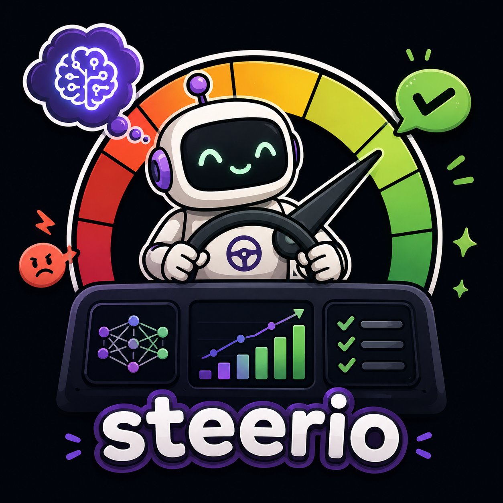

<p align="center">
  
</p>

# steerio

> **A thesis, an implementation, three experiments.** A language model can be *played* like
> a musical instrument. You don't program it with a prompt. You **turn knobs** inside its
> internal representations, that is *steering vectors* whose effect is measurable, monotonic,
> and, with caveats, transferable.

This repo implements, from scratch in stdlib-torch, two families of internal representation
control. **RepE** (Representation Engineering, Zou et al. 2023) and **CAA** (Contrastive
Activation Addition, Arditi et al. 2024), under a musical instrument API. Then it runs
**three controlled experiments on 5 real models (4 families)**: steering vs prompting,
cross model steerability, direction transfer.

> **Academic honesty.** This is NOT a new method. It is a clean, reproducible implementation
> of published methods plus a **systematic empirical evaluation** (Exp. 1 to 3), which is our
> contribution. Every number in the README is the real output of the scripts in
> `experiments/`, regenerable command by command.

---

## 1. Why

Today, controlling a LLM means writing a prompt, an instruction whose effect is fuzzy,
unmeasurable, and sensitive to wording. The alternative demonstrated here: expose a **tuning
interface** on the model's internal representations.

| | Prompt "be careful" | Knob "caution" (steering) |
|---|---|---|
| Acts on | the text the model reads, it decides to obey | the internal representation, a direct shift |
| Effect | fuzzy, non monotonic | measurable, monotonic (amp to effect curve) |
| Cost | instruction tokens on every call | one added vector, near zero |
| Inverse | "don't be positive" is weak | negative amplitude, inverted control |
| Portability | tied to the wording | knobs saved and reloaded, cross family transfer not shown (Exp. 3) |

The claim is not that steering replaces prompting. It is **orthogonal control**, with clear
limits (section 6).

## 2. API in 30 seconds

```python
from steerio import Instrument, prompts   # POS/NEG come from the prompts module

inst = Instrument("openai-community/gpt2")          # loads a local model

# 1. Make a knob by contrast (CAA)
inst.make_knob("positive",
               positive=prompts.SENTIMENT_POSITIVE,
               negative=prompts.SENTIMENT_NEGATIVE,
               layer=7)

# 2. Play a note: turn the knob, listen to the continuation
inst.play("The book was", max_new_tokens=24, knobs={"positive": 2.0})

# 3. Polyphony: several knobs at once
inst.play("Dear team,", max_new_tokens=24, knobs={"positive": 0.5, "formal": 1.0})

# 4. Read a concept (RepE)
inst.read("I love this wonderful day.", name="positive")
#   → {"cosine": 0.21, "projection": 0.94}
```

CLI: `python -m steerio play|build|benchmark` (see `--help`).

## 3. Installation

```bash
pip install -e .        # torch, transformers, numpy
python -m pytest tests/ -q   # 44 tests (tiny-random-gpt2, no real weights needed)
```

## 4. Experiments, common protocol

The 3 experiments share a strict protocol, designed to be **honest and reproducible**:

- **Directions**: CAA (raw contrast) on the layer at 60% depth (`layer_ratio=0.6`),
  amplitude 1 equals about one full contrast.
- **Generation**: greedy, fixed seed, short `max_new_tokens`.
- **Measurement**: **external lexical scorers** (sentiment, formality, refusal),
  independent of the model. We never measure with the steered model's own logits.
- **Native mode**: *instruct* models are evaluated **in chat template** (their real usage
  mode); gpt2 in base continuation. Methodological finding: evaluating an instruct model in
  raw continuation **cancels** the steering effect (0.000), whereas in chat mode the same
  knob gives +0.548 (see Exp. 1).

**Models** (≤1.5B, 4 families, local CPU load):

| Model | Family | Layers | Hidden |
|---|---|---|---|
| gpt2 | GPT-2 | 12 | 768 |
| Qwen2.5-0.5B-Instruct | Qwen | 24 | 896 |
| Qwen2.5-1.5B-Instruct | Qwen | 28 | 1536 |
| TinyLlama-1.1B-Chat | Llama | 22 | 2048 |
| DeepSeek-R1-Distill-Qwen-1.5B | DeepSeek | 28 | 1536 |

### Exp. 1. Steering vs prompting (matched control)

Same model, same evaluation prompts, same scorer. Conditions: baseline (no control), steer
+1/−1 (knob), prompt +/− (textual instruction, 2 phrasings). **Control power** = the maximum
deviation from baseline (steer at ±1; prompt, best of the 2 phrasings):

| Model | Dimension | Steering | Prompt | Best control |
|---|---|---|---|---|
| gpt2 | sentiment | +0.271 | +0.302 | prompt (thin margin) |
| gpt2 | tone | +0.047 | +0.014 | steering |
| Qwen2.5-0.5B | sentiment | **+0.535** | +0.409 | **steering** |
| Qwen2.5-0.5B | tone | 0.006 | +0.028 | prompt (both near nil) |

Qualitative results (per condition detail in `reports/experiments/exp1_*.json`):

1. **Steering is more coherent.** On Qwen2.5-0.5B, the +1 knob shifts **100%** of the 16
   prompts (sign test p=1.00), versus 85 to 92% for the best prompt. On gpt2, negative
   steering is also coherent (p=0.00, no prompt inverted), while positive prompting is not
   fully (p=0.67).
2. **Steering clearly wins on the instruct model** (+0.535 vs +0.409) at near zero marginal
   cost. On gpt2 the two controls are close. **Tone** stays hard to control either way on
   these small models (honest limit).

### Exp. 2. Cross model steerability

Amplitude sweep (5 levels) on the 5 models, 3 dimensions (sentiment, tone, defensive
refusal). Metrics: correlation of amp to score, slope, baseline. Full JSON in
`reports/experiments/`.

Correlation (Pearson over 5 amplitudes); slope = score per unit of amplitude. "refus" in
chat mode, defensive use, the direction that *raises* refusal.

| Model | Family | Sentiment corr (slope) | Tone corr (slope) | Refusal corr (baseline) |
|---|---|---|---|---|
| gpt2 | GPT-2 | **0.95** (+0.126) | 0.85 (+0.061) | (no chat) |
| Qwen2.5-0.5B | Qwen | **0.92** (+0.205) | −0.38 | **0.97** (0.50) |
| Qwen2.5-1.5B | Qwen | **0.89** (+0.120) | **0.97** | **0.97** (0.58) |
| TinyLlama-1.1B-Chat | Llama | **0.89** (+0.057) | 0.35 | −0.35 (0.08) |
| DeepSeek-R1-Distill-1.5B | DeepSeek | 0.35 | 0.69 | 0.71 (0.00) |

Honest reading:

- **Sentiment: strong on 4 of 5 families** (corr 0.89 to 0.95). **DeepSeek** (a reasoning
  model) barely responds to the sentiment knob in chat mode (0.35), a genuine, interesting
  result.
- **Tone: model dependent.** Strong on Qwen2.5-1.5B (0.97) and gpt2 (0.85), weak on
  TinyLlama (0.35), **negative** on Qwen2.5-0.5B (−0.38, the "formal" knob goes against the
  metric on this small model).
- **Refusal (defensive): strong on the Qwen models** (0.97, refusal rising 50% to 100% on
  Qwen2.5-0.5B). **TinyLlama Chat does not refuse** (baseline 8%, negative corr), the knob
  fails, the model has no refusal behavior to amplify.

### Exp. 3. Direction transfer

A. **Same hidden size** (same architecture): knob built on Qwen2.5-1.5B, applied as is to
DeepSeek-R1-Distill-Qwen-1.5B (1536 dims).
B. **Different hidden size**: gpt2 knob (768) projected by zero padding onto Qwen2.5-0.5B
(896), proportional layer. Metric: **transfer coefficient** = transferred effect over native
effect.

| Design | Source → Target | Hidden | Native delta | Transferred delta | Transfer coef. |
|---|---|---:|---:|---:|---:|
| A, same hidden | Qwen2.5-1.5B → DeepSeek-R1-Distill-1.5B | 1536→1536 | 0.000 | 0.000 | inconclusive |
| B, zero pad cross family | gpt2 → Qwen2.5-0.5B | 768→896 | +0.535 | **−0.115** | **−0.21** |

Honest, important result: **naive direction transfer fails.**

- **Design B**: the gpt2 vector, zero pad projected onto Qwen2.5-0.5B, produces a **negative**
  effect (coefficient −0.21). It *counter steers* sentiment instead of pushing it. A
  steering vector is therefore **not portable across families** by simple projection.
- **Design A**: inconclusive. DeepSeek is barely steerable in sentiment natively (corr 0.35,
  Exp. 2), so there is no native reference effect to transfer. Transferring to a non
  steerable target cannot demonstrate transfer.

## 5. Results

**Honest synthesis of the three experiments:**

1. **Steering is real, measurable, and often better than prompting.** Coherent on 100% of
   prompts (Exp. 1), high amp to effect correlation on sentiment for **4 of 5 families**
   (Exp. 2), powerful defensive refusal on the Qwen models (50% to 100%).
2. **But it is not magic or universal.** Tone is hard to control on these small models,
   DeepSeek (reasoning) barely responds to sentiment steering, and **cross family direction
   transfer fails** by naive projection (Exp. 3, coef −0.21).
3. **This repo is a reproducible implementation plus an honest empirical evaluation**, not a
   new method. The contribution is the protocol (external scorers, native mode, true
   baselines, timestamped JSON reports) and the results, including the negative ones.

## 6. Honest limits

1. **Raw tuning.** A steering vector shifts a direction. It can degrade global coherence.
   Not magic alignment.
2. **Small models.** Benchmarks are ≤1.5B on CPU. Correlations on bigger models (7B+) are
   still to be measured.
3. **Motivated adversary.** An aggressive prompt injection can beat a vector.
4. **You have to build the knobs.** A prompt is written on the spot. A knob is built by
   contrast (preparation cost).
5. **Exp. 1.** Prompting is formulation sensitive. Two phrasings tested, not a systematic
   instruction search.
6. **Defensive use.** The refusal benchmark only provides the direction that **raises**
   refusal. No comply direction.

## 7. Reproduction

```bash
python experiments/run_all.py --exp1 --exp2 --exp3   # ~40 min CPU, 5 models
```

Each experiment writes timestamped JSON reports to `reports/experiments/` plus a `SUMMARY.md`.
Weights (`models_cache/`) are downloaded in copy mode (no symlinks, Windows friendly) and
gitignored.

## 8. References

- Zou et al., *Representation Engineering*, arXiv:2310.01405 (ICLR 2024).
- Arditi et al., *Refusal in Language Models Is Mediated by a Single Direction* (CAA), arXiv:2406.11717.
- Turner et al., *Activation Addition*, arXiv:2308.10248.
- Templeton et al. (Anthropic), *Scaling Monosemanticity* (2024).

## License

MIT. See [LICENSE](LICENSE).
